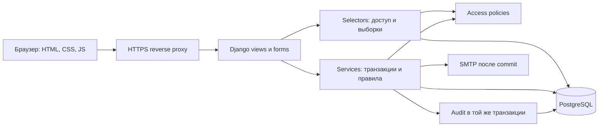
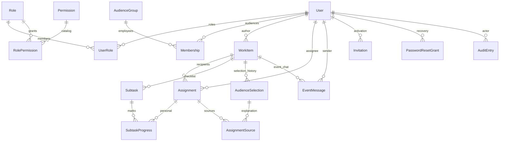

# Архитектура трекера задач колледжа

Статус: проектирование и этапы 1–4 приняты; реализован этап 4: личный прогресс, редактирование, исполнители, статистика, история и архив. Основание: [SPEC.md](SPEC.md). Здесь описана целевая архитектура целиком; текущая реализация и реально выполненные проверки отдельно в [STATUS.md](STATUS.md). Полный интерфейс реализован в этапе 5; чат относится к этапу 6.

## 1. Границы и стек

Один модульный Django-проект, серверный HTML, PostgreSQL как единственный источник рабочих данных. Пользователи — сотрудники; сущностей студентов нет. Группы адресатов отделены от ролей доступа. В первой версии нет отдельного frontend, API для сторонних клиентов, вложений, WebSocket, push, студенческих интеграций и почтовых уведомлений о чате.

| Компонент | Принятое решение | Фиксация при реализации |
| --- | --- | --- |
| Python | Docker 3.12.15; host-интерпретатор 3.12.14 | Patch + digest закреплены в Dockerfile; runtime проверен внутри образа |
| Django | 5.2 LTS, исходная зависимость `Django==5.2.18` | Зафиксировать точные версии и хеши всего дерева; перед установкой проверить новые security-релизы 5.2 |
| PostgreSQL | 17.11, без обязательных расширений | Patch + digest закреплены в Compose; клиенты dump/restore той же major-версии |
| Драйвер | `psycopg[binary]==3.3.6` | Lock с хешами, включая binary-пакет; установка только с проверками |
| HTTP production | `gunicorn==26.2.0`, WSGI, reverse proxy с HTTPS | Lock Python-зависимостей; образ reverse proxy фиксируется при развертывании |
| Интерфейс | Django Templates, собственный CSS, небольшой обычный JS | Без Node и отдельной frontend-сборки; Серверное превью работает без JS; небольшой JS добавляет строки подзадач, обновление чата — этап 6 |
| Локальная среда | Docker Compose v2: `web`, `db`, `mailpit`, явный `migrate`, `tests` | Mailpit 1.31.4 закреплен digest, только development |
| Проверки | Django test runner на PostgreSQL; Playwright Python для браузера | Версии браузерных инструментов фиксируются перед их установкой на этапе 7 |

На этапе 1 созданы requirements.in и полный requirements.lock с точными версиями и хешами, образы закреплены digest; установка и сборка проверены. Новые версии требуют совместимости и проверок, а не автоматического перехода между major-ветками. Django 5.2 официально поддерживает Python 3.12, PostgreSQL 14+ и psycopg 3.1.8+; выбранные ветки совместимы по документации и проверены в каркасе.

## 2. Модули и слои

| Django app | Ответственность |
| --- | --- |
| `accounts` | Сотрудники, корпоративная почта, приглашения, вход, восстановление, сессии, bootstrap администратора |
| `access` | Каталог разрешений, роли, назначения ролей, объектная политика, защита последнего администратора |
| `audiences` | Группы адресатов, членство, вычисление и объяснение списка получателей |
| `workitems` | Задачи/события, назначение, подзадачи, личный прогресс, статистика, архив |
| `discussions` | Чат событий, пагинация, отправка, закрытие, скрытие сообщений |
| `audit` | Неизменяемые записи действий и истории, доступ к журналу |

В каждом app: `models` описывают структуру и ограничения; `services` выполняют изменения; `selectors` возвращают уже ограниченные по доступу данные; `policies` отвечают на вопросы о действиях; HTTP views/forms валидируют ввод и вызывают эти слои. Политики из `access` используются везде; шаблон только показывает результат их решения. Выборки не возвращают лишние данные с надеждой скрыть их в HTML.

Реализованный `core` — технический модуль для общих HTTP middleware, health/errors, management-команд и инфраструктурных тестов; не седьмой предметный модуль. Этап 1 добавил User, AccessGuard и AuditEntry. Этап 2 добавил Role/Permission/UserRole, AudienceGroup/Membership, Invitation/PasswordResetGrant/RateLimitBucket; Этап 3 добавил WorkItem/Assignment/Subtask, AudienceSelection и выбранные источники, AssignmentSource и MutationReceipt выдачи; discussions пока пуст. Стандартные auth/contenttypes/session migrations Django установлены для механизмов авторизации; стандартные auth.Group не используются как роли или группы адресатов.

Административный интерфейс версии 1 — собственные Django views на этих же services/selectors. Стандартный Django Admin с универсальным CRUD не подключается, чтобы не получить обход журналирования, персональных прав и блокировок. Команды управления используют те же операции; прямые ORM-изменения из shell не являются поддерживаемым административным workflow. DBA и владелец сервера входят в доверенную инфраструктурную границу.

## 3. Основные понятия и жизненные циклы

**Сотрудник:** приглашен → подтвердил почту и установил пароль → работает; отключение запрещает вход и текущие запросы, отзывает назначения и сессии. Активность аккаунта и подтверждение почты — разные поля. Активного уже приглашенного сотрудника можно назначить до активации почты; доступ он получит только после подтверждения. Это явное допущение D1 из [DECISIONS.md](DECISIONS.md).

**Задание:** `task` или `event`, сразу выдаваемое без отдельной сущности черновика; открытое → архивное. Автор и тип после выдачи неизменяемы. Событие имеет `event_at`, независимо от `due_at`. Завершения всех исполнителей не закрывают событие и чат автоматически. Чат можно закрыть, повторное открытие не входит в первую версию.

**Назначение:** одна строка на пару задание/пользователь навсегда; состояние доступа `active`/`revoked`, отдельно `completed_at`. Возврат очищает `completed_at`, но сохраняет чекбоксы. Отзыв сохраняет историю и прогресс; повторное добавление использует ту же строку. Отдельная новая дата назначения записывается при каждом восстановлении; первая дата также сохраняется.

**Действующее назначение:** `state=active AND user.is_active`. Неподтвержденный, но уже приглашенный активный сотрудник входит в число получателей. Деактивация пользователя транзакционно переводит его назначения в `revoked`, в том числе в архиве. Реактивация пользователя их не восстанавливает. Архив сохраняет состояния, но запрещает выполнение, редактирование содержания и отправку сообщений.

**Просрочка:** действующее незавершенное назначение неархивного задания, для которого `due_at < now()`. Это вычисляемый признак, а не состояние. Он не запрещает выполнение. Текущие вкладки личных задач не включают архив; архив доступен отдельным фильтром для чтения.

## 4. Модель данных

У рабочих сущностей UUID PK; служебные журналы/сообщения используют монотонный bigint PK для курсоров. Все даты `timestamptz`, UTC. Для ссылок на исторические данные — `PROTECT`/`RESTRICT`; обычное приложение не удаляет пользователей, роли, группы, задания, подзадачи и назначения физически. Таблица описывает целевую модель целиком; реализованное подмножество отмечено в STATUS.

| Сущность | Основные поля и связи | Ограничения и назначение |
| --- | --- | --- |
| `User` (`accounts`) | `id`, `full_name`, `email`, `password`, `is_active`, `email_verified_at`, `invited_at`, `auth_version`, `created_at`, `updated_at`, `version` | Кастомная модель на `AbstractBaseUser` с начала проекта; `USERNAME_FIELD=email`; пароль — Django hash; уникальная нормализованная почта |
| `Role` (`access`) | `id`, неизменяемый `key`, редактируемый `name`, `is_active`, `is_system_admin`, `version` | Единственная системная роль администратора; ее системный признак нельзя выставить из формы; отключенные роли не дают прав |
| `Permission` (`access`) | неизменяемый уникальный `code`, русское название, `admin_only` | Заранее определенный каталог, добавление видов только миграциями/кодом; не Django audience-группа |
| `RolePermission` | `role_id`, `permission_code` | UNIQUE пары; только разрешенные для этой роли коды |
| `UserRole` | `user_id`, `role_id`, `created_at`, `created_by` | UNIQUE пары; снятие связи записывается в AuditEntry |
| `AudienceGroup` (`audiences`) | `id`, `name`, `is_active`, `version` | Имя уникально без учета регистра; отключение не отзывает ранее выданные задания |
| `Membership` | `user_id`, `audience_group_id`, `created_at`, `created_by` | UNIQUE пары; не дает разрешений; снятие сохраняется в аудите |
| `WorkItem` | `id`, `kind`, `title`, `description`, `author_id`, `created_at`, `due_at`, `event_at`, `archived_at/by`, `chat_closed_at/by`, `version`, `progress_epoch` | `event_at` обязателен только у события; у задачи NULL и нет чат-полей; автор/тип неизменяемы |
| `Assignment` | `id`, `work_item_id`, `user_id`, `state`, `first_assigned_at`, `assigned_at`, `assigned_by`, `revoked_at/by/reason`, `completed_at`, `completion_epoch`, `version` | UNIQUE `(work_item_id,user_id)`; CHECK согласованности отзыва и состояния; CHECK пары полей завершения; никакого общего completed у WorkItem |
| `Subtask` | `id`, `work_item_id`, `text`, `position`, `content_revision`, `created_at`, `deleted_at` | Стабильный id; мягкое удаление; позиция не идентичность; частичный UNIQUE `(work_item_id,position)` для неудаленных |
| `SubtaskProgress` | `id`, `work_item_id`, `assignment_id`, `subtask_id`, `checked_at`, `checked_revision`, `version` | UNIQUE `(assignment_id,subtask_id)`; отметка действительно выполнена только для текущей `content_revision` |
| `AudienceSelection` | `id`, `work_item_id`, `batch_id`, `selected_by/at` | Неизменяемая запись первоначальной выдачи или последующего явного добавления адресатов |
| `AudienceSelectionUser/Role/Group` | FK к selection, соответствующему адресату, `label_snapshot` | UNIQUE в пределах selection; сохраняет исходные выборы и имена на момент выдачи, даже после переименования |
| `AssignmentSource` | `assignment_id`, ровно один FK к выбранному user/role/group, `batch_id` | CHECK выбора ровно одного источника и UNIQUE assignment/источник; хранит причины пересечения, не дублируя Assignment; источник принадлежит тому же заданию |
| `EventMessage` | bigint `id`, `work_item_id`, `author_id`, `text`, `created_at`, `hidden_at/by`, `hidden_reason`, `last_change_id` | Только событие; неизменяемый обычный текст; скрытие вместо удаления; причина обязательна при скрытии; last_change_id — id аудита создания/скрытия, курсор изменений |
| `Invitation` | `id`, `user_id`, `email_snapshot`, `token_digest`, `created_by/at`, `expires_at`, `used_at`, `revoked_at`, `version` | Секрет токена не хранится; UNIQUE digest; не более одной неиспользованной неотозванной ссылки на пользователя |
| `PasswordResetGrant` | `id`, `user_id`, `token_digest`, `expires_at`, `used_at`, `revoked_at`, `auth_version` | Штатный токен Django плюс серверное одноразовое состояние для конкурентной обработки; без открытого секрета |
| `MutationReceipt` | `actor_id`, `operation`, `request_key`, `payload_digest`, FK к результату, `created_at` | UNIQUE `(actor_id,operation,request_key)`; защита повторной выдачи формы и отправки сообщения |
| `AuditEntry` | bigint `id`, `actor_id` (NULL только для системного события), `actor_label`, `action`, `object_type/id`, `occurred_at`, `request_id`, `changes`, `reason` | Append-only; разрешенный список полей changes; ни токенов, ни паролей, ни cookie, ни текста чата |
| `AccessGuard` | Одна предсозданная строка `id=1` | Синхронизация отзывов прав и защищенных операций; не редактируется через UI |
| `RateLimitBucket` | `scope`, `key_digest`, `window_start`, `count`, `expires_at` | UNIQUE `(scope,key_digest,window_start)`; лимиты общие для WSGI workers, атомарные; истекшие технические записи очищаются |
| Django `Session` | штатное DB session storage | В cookie только идентификатор; `auth_version` хранится в серверной сессии и проверяется при каждом запросе |

`UserRole`, `RolePermission`, `Membership` — отдельные through-модели. Роли доступа реализуются собственными Role/Permission; стандартные `auth.Group` и пользовательские arbitrary permissions не подключаются параллельно. Формы входа и backend работают с Django hashers/validators/session auth, объектные права — собственная явная политика. Системный администратор определяется через защищенную Role, без отдельного HTTP-редактируемого `is_superuser`. Все его изменения также проходят аудит.

### Ограничения БД и индексы

1. Почта: trim, ASCII lowercase всего адреса, Django email validation, затем точное сравнение домена с `corp.kp11.ru`. Не принимать display-name, поддомены, похожие/Unicode-домены; не удалять точки и `+suffix`. БД: UNIQUE email плюс CHECK `email=lower(trim(email))` и точного домена; это обеспечивает уникальность нормализованных адресов без второго дублирующего functional index. Уникальность включает отключенных сотрудников. Изменение почты после приглашения в V1 запрещено, чтобы не обходить подтверждение; имя можно менять.
2. `Assignment` и `SubtaskProgress` имеют описанные UNIQUE. Совпадение заданий у progress обеспечивается на уровне БД: дополнительный `work_item_id`, UNIQUE `(id,work_item_id)` у Assignment и Subtask, два составных FK `(assignment_id,work_item_id)` и `(subtask_id,work_item_id)`. Эти FK вводятся обратимой SQL-миграцией и сопровождаются тестами. `Model.clean()` и межтабличный CHECK этого не гарантируют.
3. Чат только у события: service проверяет kind, дополнительный триггер БД запрещает EventMessage для task; смена kind запрещена. Не использовать межтабличный CHECK. Исторические текстовые ревизии подзадач фиксируются в AuditEntry при изменении/удалении.
4. Индексы: WorkItem `(author_id,archived_at,due_at,id)`, `(archived_at,kind,due_at,id)`; Assignment `(user_id,state,completed_at,work_item_id)`, `(work_item_id,state,completed_at)`; Subtask `(work_item_id,deleted_at,position)`; EventMessage `(work_item_id,id)`, `(work_item_id,last_change_id)`; AuditEntry `(object_type,object_id,id)`, `(actor_id,occurred_at,id)`; Invitation `(user_id,expires_at)`; expiration-индексы у технических reset/rate-limit записей. FK индексы Django и обратные индексы ролей/членства для разрешения адресатов. Проверить реальные планы выборок после реализации; не добавлять дублирующие индексы без причины.
5. NOT NULL/длины/положительные версии, допустимые enum-состояния, согласованность hidden-полей, сроков токена и состояния назначения задаются CHECK. Ограничение «последний администратор» и сложные переходы выполняются в services под общими блокировками, а не выдаются за простые ограничения строки.

## 5. Назначение и личный прогресс

### Выдача и изменение адресатов

Форма принимает пользователей, роли и группы. Selectors возвращают только активных приглашенных сотрудников, допустимые роли и группы; выбора архивных справочников нет. Результат — объединение по ИЛИ и устранение повторов по User.id. На сервере повторно строится список, сохраняется snapshot выбора и причин. Полный справочник адресатов доступен создателю/управляющему назначениями только в этом контексте: ФИО, роль, группа, без паролей, почты и профилей.

Превью содержит окончательный список и количество. Финальная выдача должна совпадать с подтвержденным превью: подписанное представление ids/параметров со сроком жизни 10 минут сравнивается с заново вычисленным результатом под блокировкой. Изменение состава между превью и отправкой требует нового превью и подтверждения, а не молчаливой выдачи другому набору людей. Создание WorkItem, Subtask, Assignment, источников, MutationReceipt и AuditEntry — одна транзакция. Пустой исходный список при создании запрещен; ноль исполнителей допускается после отзывов.

Изменения ролей/групп не пересчитывают ранее выданные назначения. Добавление по группе позднее — новая явная операция со своим snapshot, а не подписка на группу. Deactivation группы или роли тоже не отзывает Assignment. Снятие роли может убрать право управления, но человек сохраняет личный доступ, пока у него есть действующее назначение.

Отзыв сохраняет строки и историю, немедленно убирает назначение из статистики и доступа. Повторное добавление показывает автору прошлый прогресс до подтверждения и восстанавливает только совместимый с текущим содержанием прогресс; детали D3 в DECISIONS. Идемпотентная повторная операция не меняет дату назначения второй раз.

Реализация этапа 3: HTML-форма и отдельное серверное подтверждение без обязательного JS. Подпись Django связывает автора, UUID запроса, канонические поля и снимок адресатов/названий/всех причин; lifetime 600 секунд. Сервер повторно вычисляет снимок под write guard; устаревший или измененный снимок дает 409 с новой формой. Отключенный выбранный справочник дает ошибку выбора. Receipt проверяется после текущих прав; прежний успешный результат доступен даже после истечения превью/изменения membership, другой payload дает 409. Receipt и источники защищены от изменения/удаления runtime grants и SQL triggers. БД защищает принадлежность источника тому же заданию/batch, author/kind и identity назначения. Первоначальный непустой список обеспечивает service под guard; shell/DBA вне поддерживаемого workflow.

Выборки этапа 3: личные действующие назначения, авторские с view_own, все с view_all, карточка по объединению оснований. Roster — только по view_own автора/view_all; в chooser и roster нет email/профилей. Семантические object-действия `workitems.read/read_roster/edit/manage_assignees` вычисляет политика; это не дополнительные выдаваемые permissions. Этап 4 реализовал редактирующие endpoints и progress по правилам ниже; полный интерфейс относится к этапу 5.

### Правила подзадач

| Изменение | Личный прогресс | Завершение |
| --- | --- | --- |
| Заголовок, описание, срок | Сохраняется | Сохраняется |
| Только порядок подзадач | Сохраняется, stable id | Сохраняется |
| Новая подзадача | У действующих назначений новая отметка пустая; остальные прежние | У всех действующих очищается completed_at; progress_epoch +1 |
| Новый текст подзадачи | Ее content_revision +1; у действующих только ее отметка очищается | У всех действующих очищается completed_at; progress_epoch +1 |
| Удаление подзадачи | deleted_at; прошлый текст/отметки в истории, текущий checklist без нее | Существующее завершение сохраняется; незавершенное не завершается автоматически |
| Возврат назначения | Чекбоксы сохраняются | completed_at/completion_epoch очищаются; прежнее завершение остается в аудите |

«Все действующие» включает активных приглашенных до подтверждения почты; отозванный прогресс хранится без текущего сброса. Перед сбросом выполнения показываются конкретные последствия: затронутые назначения и число выполненных. Подтверждение привязано к версии задания и набору изменений; если появились новые выполнения или получатели, последствия пересчитываются и подтверждаются заново. Массовый сброс, изменение текста и аудит коммитятся вместе.

Реально отмечена подзадача, если `checked_at != NULL AND checked_revision = subtask.content_revision` и subtask не удалена. Выполнить назначение можно только самому исполнителю, при действующем доступе, неархивном задании и всех текущих отметках. Без подзадач условие истинно. Сервер записывает время и текущий progress_epoch. Отметки завершенного назначения менять запрещено до «Вернуть»; назначенные варианты «отметить true/false» идемпотентны.

Автор/администратор не выставляет персональные чекбоксы от имени сотрудника. Массовый сброс при содержательных изменениях — отдельная разрешенная операция с аудитом, а не ручное изменение чужого прогресса.

Статистика считается SQL-агрегацией по действующим Assignment: completed / total × 100, округление для экрана до целого процента; при total=0 — «Нет исполнителей». 3/5 = 60%; частичные чекбоксы не входят в completed. У WorkItem нет отдельного агрегатного статуса, который мог бы рассинхронизироваться.

Реализация этапа 4: SubtaskProgress — техническая through-строка с внутренним bigint id; ее стабильная персональная идентичность задается парой Assignment UUID/Subtask UUID. Два составных FK исключают прогресс чужого задания; версии проверяются на уровне задания, назначения и отметки. Missing progress старых назначений заполняется миграцией; новые назначения/подзадачи получают пустые строки. Сброс изменяет только действующие назначения; отозванные строки сохраняют прошлые ревизии до явного восстановления, при котором несовместимые отметки очищаются, completion восстанавливается только при текущем epoch и всех совместимых отметках.

Все редактирования сначала показывают подписанное превью (600 секунд), связанное с автором запроса, заданием, его версией, полями и последствиями. Для содержательного сброса снимок включает конкретные назначения, их версии и даты завершения; изменения после превью требуют нового подтверждения. Конфликт версии не сохраняет старый ввод поверх нового: HTTP возвращает 409 с сохраненным вводом и требует нового превью. Reorder освобождает частичный UNIQUE внутри транзакции через временное deleted_at, затем возвращает текущие строки на новые позиции; внешние чтения не видят промежуточного состояния.

Отзыв и добавление изменяют version задания. Отключение пользователя отзывает все его активные назначения, включая архив; реактивация их не восстанавливает. Миграция этапа 3 → 4 также отзывает ранее активные назначения уже отключенных сотрудников, используя актор прежнего отключения из неизменяемого аудита и записывая системное событие перехода. Если подтверждающего аудита нет, миграция останавливается вместо выдумывания актора; прямые изменения БД вне services не поддерживаются. Archive необратим в V1, сохраняет данные, закрывает записи; DB trigger запрещает его отмену. История объекта фильтруется по текущему чтению: исполнитель получает собственные действия и метаданные изменений, без чужих отметок/списков; автор с view_own и view_all получают ревизии содержания и историю исполнителей.

## 6. Транзакции, конкуренция и история

Для V1 с небольшим числом сотрудников выбирается простой проверяемый протокол синхронизации на PostgreSQL READ COMMITTED. Он сознательно сериализует изменения и может стать узким местом при большой нагрузке; более сложная схема блокировок откладывается до измерений.

- Каждая защищенная запись начинает `transaction.atomic()` и захватывает единственную AccessGuard через `SELECT FOR UPDATE`. Только затем заново читает текущего пользователя, роли, объектные связи, блокирует нужные строки и проверяет права. Блокировка держится до commit/rollback. Это касается выполнения, чата, редактирования, выдачи, активации и административных операций.
- Защищенные чтения берут AccessGuard через `SELECT FOR SHARE` в короткой явной транзакции, затем перечитывают активность, auth_version и права, выполняют ограниченную выборку и полностью формируют ответ. Потоковых ответов с поздней ORM-выборкой нет. Чтения могут идти одновременно; отзыв прав ждет уже начатое чтение, последующие чтения видят результат отзыва.
- Порядок: AccessGuard → User по id → WorkItem по id → Assignment → Subtask/Progress → прочие строки. Ни SMTP, ни ожидание внешнего API, ни отправка ответа по сети не держат транзакцию. RateLimitBucket обрабатывается в своей завершенной короткой транзакции до этого протокола; не оставляет обратной зависимости блокировок.
- Middleware защищенного POST проверяет сессию под read guard и освобождает его; бизнес-service начинает собственный write guard и повторно проверяет actor/auth_version/права. При показе POST-формы после операции или ошибки снова проверяются доступ и epoch под read guard, который держится до окончания рендера. Это исключает повышение shared lock до write lock и позволяет завершить лимит до бизнес-транзакции. Хеширование нового пароля выполняется до guard; действительность ссылки/пароля и пользователь повторно проверяются внутри.
- У редактируемых справочников, WorkItem, Assignment и Progress есть integer version. Формы передают ожидаемую версию; несовпадение возвращает 409 с сохранением введенных данных и новым превью, без перезаписи чужого изменения. Проверка идет после блокировки. Конкурентное выполнение и изменение подзадачи также упорядочены: изменение после выполнения снимает его; выполнение после изменения требует актуальных отметок.
- Проверка последнего администратора выполняется после потенциального изменения под AccessGuard: должен остаться хотя бы один активный, подтвержденный сотрудник с пригодным паролем и активной системной ролью Administrator. Проверяются отключение аккаунта/роли и снятие UserRole, включая составные формы. До bootstrap допускается ноль. Локальная команда под guard создает первое приглашение только при отсутствии назначенной системной роли и записи accounts.bootstrap_started. После начала bootstrap допускается только --resend на тот же еще не активированный адрес; после активации повторный bootstrap запрещен. Факт начала сохраняется в неизменяемом аудите; аварийное восстановление относится к отдельной доверенной процедуре этапа 7.
- MutationReceipt: клиентский UUID, digest канонического ввода, операция и actor; тот же ключ/тот же ввод возвращает прежний результат только после повторной проверки текущего доступа, тот же ключ/другой ввод дает 409. Receipt, объект и аудит атомарны. Ключи выдачи и чата сохраняются вместе с историей объектов, а не истекают при следующем обновлении страницы. Версия формы все равно обязательна для содержательных изменений.
- AuditEntry коммитится с действием; невозможность журналирования откатывает действие. Включает назначения/отзывы, повторы назначения, завершения/возвраты, массовые сбросы, ревизии задания/подзадач, роли/членство, приглашения (метаданные), архивирование, закрытие и модерацию чата. Даже no-op повтор не создает второй запись действия. Служебная runtime-роль БД может вставлять/читать аудит, но не обновлять/удалять его; DDL и миграции — отдельная учетная запись.

«Немедленно» означает проверку каждого нового серверного запроса по текущему состоянию и отсутствие записи после commit отзыва. Уже доставленный браузеру текст невозможно отозвать; защищенные ответы имеют `Cache-Control: no-store`. На следующем 401/403/404 polling прекращается, содержимое чата очищается и показывается сообщение об утрате доступа. Открытая страница не является источником прав.

## 7. Авторизация, почта и безопасность

- Нет открытой регистрации и bootstrap-маршрута. До входа доступны только вход, активация, восстановление и нужная для них статика. Внутренний healthcheck доступен инфраструктуре и не раскрывает рабочие данные.
- Администратор приглашает нормализованную корпоративную почту. Invitation содержит digest ссылки, а ссылка — подписанный Django signing payload с id приглашения и случайным nonce от `secrets`, без почты. Хеш/digest и постоянное сравнение — штатные криптографические примитивы; самостоятельно разработанного алгоритма нет. Срок приглашения по умолчанию 48 часов, восстановления 1 час; настройки серверные.
- GET активации ничего не активирует: отображает форму. POST с CSRF, еще действительным токеном и валидным паролем под блокировкой атомарно подтверждает email, устанавливает Django password hash, помечает токен used и отзывает остальные ссылки. Переотправка сразу отзывает предыдущую ссылку; отключенному аккаунту активация запрещена. При смене email_snapshot приглашение непригодно.
- EmailBackend использует штатный `authenticate`/`check_password`, неактивные/неподтвержденные пользователи входить не могут; password validators включены. Default Django PBKDF2 — исходный поддерживаемый hasher; самодельного хеширования паролей нет. После восстановления атомарно меняются пароль и auth_version, отзываются reset grants и старые сессии. При обычной смене пароля сохраняется только текущая сессия через Django session auth hash, остальные недействительны.
- Сам токен восстановления формирует Django `PasswordResetTokenGenerator`; дополнительная PasswordResetGrant гарантирует одноразовость при конкурентных POST. Восстановление через подтвержденную почту с одинаковым внешним ответом для существующих/несуществующих аккаунтов; нельзя считать только стандартный expiry доказательством конкурентной одноразовости.
- Ссылки отправляются через Django email backend после успешного commit (`on_commit`), вне блокировок. Ошибка SMTP не откатывает сохраненное приглашение: администратор видит ошибку доставки и может переотправить, отозвав ссылку. Секрет остается только в краткоживущем процессе отправки; постоянного outbox с открытым токеном нет. Сбой между commit и отправкой устраняется переотправкой.
- Bootstrap: локальная команда `bootstrap_admin --email ... --full-name ...` создает приглашенного сотрудника и системную роль, отправляет приглашение; доступ возникает после безопасной активации. Без стандартного пароля и вывода ссылки в обычные логи. Ошибка SMTP не откатывает приглашение: команда сообщает неподтвержденную доставку; после исправления SMTP --resend отзывает старую ссылку. Пароль и ссылка не выводятся командой.
- DB sessions; cookies HttpOnly, production Secure, SameSite=Lax; HTTPS, CSRF для всех изменяющих запросов, смена session key при входе. Никаких credentials/рабочих данных в localStorage. Защищенные ответы no-store, Referrer-Policy=strict-origin: только origin без пути и query, включая страницы токенов; no-referrer давал Origin:null при POST локальных HTTP-форм Chromium (выявлено браузером в этапе 5); reverse proxy не пишет секретные URL и тела форм в access/error logs.
- Лимиты до SMTP/дорогого password hash, общие для workers: вход 5 попыток/5 минут на email+IP и 30/5 минут на IP; восстановление 3/час на email и 20/час на IP; приглашение/переотправка 3/час на адрес и 60/час на администратора; чат 10 сообщений/минуту на пользователя в одном событии и 30/минуту на пользователя суммарно по всем событиям. Ответ 429 с Retry-After; настройки корректируются после проверки нагрузки. В development используется REMOTE_ADDR; произвольный X-Forwarded-For игнорируется. Перед production требуется настроить передачу IP только доверенным proxy (P1). Лимиты восстановления не раскрывают наличие аккаунта.

## 8. Чат и интерфейс

Только для event. Доступы подробно определены в [PERMISSIONS.md](PERMISSIONS.md). Обычный текст 1–4000 символов, пустой после trim отклоняется. Autoescape Django обязателен; не применять `safe`, а JS вставляет текст через `textContent`. Имена студентов допускаются только в тексте, не моделируются.

История по 50 сообщений, курсор по id; предыдущие — `before_id`, а не полный reload. Polling изменений использует отдельный монотонный `last_change_id` из AuditEntry: создание и скрытие сообщения транзакционно обновляют его. Запрос `changes_after` получает новые сообщения и заглушки скрытых, включая уже показанные в браузере; один `after_id` не обнаружил бы скрытие старого сообщения. Сам журнал аудита через chat endpoint не выдается. Первичная загрузка и watermark согласованы под shared guard; порции ограничены 50, курсор продвигается только до последнего выданного изменения, чтобы не терять остальные. Состояние закрытия/архива проверяется при каждом polling.

По умолчанию polling каждые 10 секунд на видимой вкладке, при ошибках backoff до 60 секунд. Каждый запрос проверяет доступ заново. Показываются имя автора и его текущие активные группы; это исключение для авторов видимых сообщений, не общий список исполнителей/членов групп. Эти подписи перечитываются при загрузке сообщений; при следующем обновлении видимой страницы также обновляются подписи уже показанных авторов. Нельзя раскрывать email или чужие отметки через данные чата.

Пользователь не редактирует сообщения. Модерация заменяет текст для обычных читателей заглушкой с причиной, не выдает оригинал в HTML/JSON. Исходный текст остается в EventMessage и доступен отдельным selector только системному администратору с правом аудита; модератору без такого статуса оригинал после скрытия не доступен. Скрытие журналирует id и причину, без копии текста. Закрытый чат читается; отправка запрещена всем, включая администратора. В архиве нельзя ни отправлять, ни модерировать; системные отзывы доступа продолжают работать.

Навигация: «Мои задачи» для каждого действующего пользователя; «Выданные» для обладателя view_own; «Все задания» отдельно для view_all; «Администрирование» по конкретным правам. В «Мои задачи» вкладки «Назначены»/«Выполнены», фильтры автора и вида, сортировка due_at ASC/DESC с id как tie-breaker. Доступные фильтры строятся только по доступным заданиям; они не раскрывают скрытых авторов.

Формы и ошибки на русском. На 360 px карточки без горизонтального scroll основной страницы; ПК — таблицы, где уместно. Крупные controls, подписи, фокус, keyboard navigation, контраст, статус текстом и цветом. При ошибках сохраняется безопасный введенный текст, но пароли/токены не возвращаются в HTML.

`USE_TZ=True`, `TIME_ZONE=Europe/Moscow`, БД UTC. Дата без времени трактуется как конец московского дня: внутренняя due_at — начало следующего местного дня минус 1 микросекунда; форма прямо объясняет это. Для события ввод даты и времени обязателен, отдельно от срока поручения. Тестируются границы московского дня.

## 9. Запуск, production и резервные копии

Development: Compose-сеть, PostgreSQL named volume, Mailpit, web с отдельными dev settings. Healthcheck `pg_isready` плюс зависимость service_healthy; миграции — отдельная явная команда перед запуском web, не параллельно в каждом worker. Только development допускает runserver. Тестовые фикстуры и приемник почты не используются production-настройками.

Production: отдельные settings/Compose override, Gunicorn за HTTPS proxy, DEBUG=False, явные ALLOWED_HOSTS и CSRF_TRUSTED_ORIGINS, static files через proxy, корректная обработка доверенного HTTPS header, безопасные заголовки и HSTS после проверки HTTPS. БД и SMTP credentials/SECRET_KEY из защищенного окружения, `.env.example` только с несекретными заглушками. БД не публикует порт наружу; runtime-роль без SUPERUSER/CREATEDB/CREATEROLE/DDL, миграционный пользователь отдельно. Журналы по whitelist, без содержимого чата, auth-параметров и cookies. Мониторинг ошибок и healthcheck не дает профили сотрудников.

Бэкапы: `pg_dump --format=custom` совместимой версии, хранятся за пределами контейнера/исходников, шифруются и доступны ограниченному оператору. Ежедневный dump и 30 дней хранения — предварительное допущение, не согласованный SLA. Проверка включает `pg_restore` в отдельную пустую БД, совпадение ожидаемых назначений, прогресса, сообщений и аудита, запуск приложения на восстановленной БД с изолированной почтой. Restore не перезаписывает рабочую БД. Секреты/конфигурация хранятся и восстанавливаются отдельным безопасным процессом; их нет в репозитории. До допуска к production обязательно реально выполнить проверку восстановления и зафиксировать время/результат. Конкретные команды и инструкции появятся с инфраструктурой на этапах 1 и 7.

## 10. Проверенные источники и пределы проверки

Документация сверена 9 октября 2026 по времени пользователя. Прямые сайты docs.djangoproject.com и postgresql.org вернули proxy 403; использованы официальные исходники документации на GitHub. Registry PyPI подтвердил опубликованные версии Django 5.2.18, psycopg 3.3.6 и Gunicorn 26.2.0. Проверка публикации/совместимости не заменяет тестирование приложения и не утверждает, что это последние версии на любой будущий день.

- [Django 5.2 LTS и Python](https://github.com/django/django/blob/5.2.18/docs/releases/5.2.txt), [PostgreSQL и psycopg](https://github.com/django/django/blob/5.2.18/docs/ref/databases.txt).
- [atomic и on_commit](https://github.com/django/django/blob/5.2.18/docs/topics/db/transactions.txt), [select_for_update и ограничения тестирования](https://github.com/django/django/blob/5.2.18/docs/ref/models/querysets.txt).
- [Session auth и смена пароля](https://github.com/django/django/blob/5.2.18/docs/topics/auth/default.txt), [безопасность](https://github.com/django/django/blob/5.2.18/docs/topics/security.txt), [production checklist](https://github.com/django/django/blob/5.2.18/docs/howto/deployment/checklist.txt).
- [Кастомная User и backend](https://github.com/django/django/blob/5.2.18/docs/topics/auth/customizing.txt), [Django signing и max_age](https://github.com/django/django/blob/5.2.18/docs/topics/signing.txt), [штатный PasswordResetTokenGenerator](https://github.com/django/django/blob/5.2.18/django/contrib/auth/tokens.py).
- [Ограничения PostgreSQL 17](https://github.com/postgres/postgres/blob/REL_17_STABLE/doc/src/sgml/ddl.sgml), [dump/restore](https://github.com/postgres/postgres/blob/REL_17_STABLE/doc/src/sgml/backup.sgml).
- [PostgreSQL: конкурентный доступ и shared/exclusive row locks](https://github.com/postgres/postgres/blob/REL_17_STABLE/doc/src/sgml/mvcc.sgml).
- [Docker Compose: startup order и healthchecks](https://github.com/docker/docs/blob/main/content/manuals/compose/how-tos/startup-order.md), [Mailpit](https://github.com/axllent/mailpit).

На этапе 0 проверены источники и согласованность проекта. После отдельного разрешения пользователя выполнен этап 1: приложение-каркас запущено, зависимости установлены с проверкой хешей, миграции и инфраструктурные concurrency-тесты проверены на PostgreSQL. Точные результаты и непроверенные части — в STATUS.md; эта архитектура не утверждает готовность последующих бизнес-функций.

## Интерфейс этапа 5

Личные вкладки и списки используют серверные GET-фильтры (автор/вид/срок) поверх ограниченных selectors. Авторы фильтра берутся только из доступных объектов; неизвестное значение дает 400 с пустым результатом. Детерминированная сортировка due_at + UUID и страницы по 20 объектов; переключение вкладки сохраняет фильтры, сбрасывая страницу. Личные карточки агрегируют только свой SubtaskProgress. Архив вынесен из текущих списков. Навигация и административный обзор показывают действия по текущим разрешениям; изменения все равно проверяются services.

Field groups Django обеспечивают label/legend/help/errors, крупные controls и видимый фокус; checklist использует серверные POST-кнопки с checkbox semantics и текстовым статусом. Обычные формы и возврат к подписанному вводу работают без JS. Имена UUID/версии не считаются доверенными. JS для добавления строк не хранит рабочие данные и не заменяет server validation.

Browser suite использует отдельные Playwright/Chromium и пустой PostgreSQL Compose project, настоящие активации через Mailpit и отдельные cookie contexts. Артефакты только в игнорируемом test-results; auth traces/HAR/video не создаются. Конкретные успешные и неудачные запуски — в STATUS.md.
